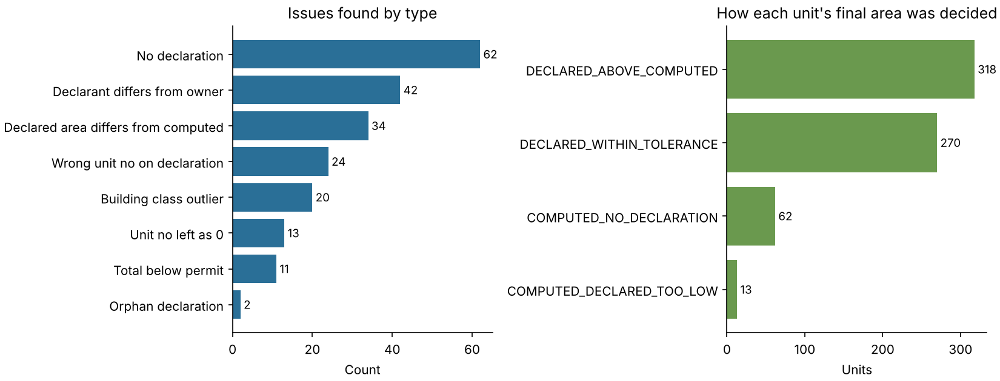

# Property Area Reconciliation

A small Python tool that reconciles **declared unit areas** against **architectural plans, deeds and building permits**, decides a final area for each independent unit, and produces a bulk-upload Excel file plus a list of data-quality issues for follow-up.

> **All data is synthetic.** It is generated by `area_reconcile/generate.py` with a fixed seed. No real person, address, parcel or municipal record is used. Problems (missing declarations, mistyped unit numbers, owner mismatches, wrong areas) are injected on purpose so the pipeline has something to find.

## Business problem
Building inventories combine sources that rarely agree: permit data, plan areas, deeds and owner declarations. Someone has to decide which area goes into the system for every unit, and chase the exceptions. Doing this by hand across hundreds of buildings is slow and inconsistent. This project encodes the rules once, so the result is repeatable and every decision is traceable.

## Rules
1. **Gross area** of a unit = net area (plan) + equal share of the building's common area (`common_area / number of units`).
2. **Final area** per unit:
   | Situation | Final area | Code |
   |---|---|---|
   | No usable declaration | computed gross | `COMPUTED_NO_DECLARATION` |
   | Declared ≥ computed | declared | `DECLARED_ABOVE_COMPUTED` |
   | Declared < computed, gap ≤ 10 m² | declared | `DECLARED_WITHIN_TOLERANCE` |
   | Declared < computed, gap > 10 m² | computed gross | `COMPUTED_DECLARED_TOO_LOW` |
3. Areas are rounded **half up** to whole m² (137.5 → 138). The tolerance is configurable (`--tolerance`).
4. **Matching** declarations to deed units: unit number + declarant → declarant alone (fixes unit no `0` or typos) → unit number alone (flags owner mismatch) → orphan.
5. **Building checks:** final total vs. permit gross area (flag if >1% below), declarations whose building class differs from the building's majority.

## Results on the synthetic run (60 buildings, 663 units)
| Final-area decision | Units |
|---|---|
| Declared above computed | 318 |
| Declared within tolerance | 270 |
| No declaration (computed used) | 62 |
| Declared too low (computed used) | 13 |

208 issues flagged: no declaration 62, owner mismatch 42, area gap 34, wrong unit no 24, class outlier 20, unit no 0 13, total below permit 11, orphan declaration 2.



## Run it
```bash
pip install -r requirements.txt
python -m area_reconcile generate      # writes data/synthetic/*.csv
python -m area_reconcile run           # writes outputs/
python -m pytest -q                    # 17 tests
```
Outputs: `outputs/units_final.xlsx` (sheets: `bulk_upload`, `units_detail`, `buildings`, `issues`), `outputs/feedback.md` (per-building notes), `outputs/summary.png`.

## Layout
```
area_reconcile/rules.py      pure business rules (no I/O)
area_reconcile/generate.py   seeded synthetic data
area_reconcile/pipeline.py   gross area, matching, decisions, issues
area_reconcile/report.py     Excel, feedback text, chart
tests/                       rule boundaries and matching behaviour
```

## Limitations
- Common area is split equally; real regulations may weight by floor or use.
- The rules and the 10 m² tolerance are a simplified model, not legal guidance.
- Matching is deterministic; fuzzy matching of names/addresses is not included.

---
**Türkçe özet:** Bu araç beyan edilen bağımsız bölüm alanlarını mimari proje, tapu ve yapı ruhsatı verileriyle karşılaştırır, her bölüm için nihai m² değerini kurala göre belirler (brüt = net + eşit paylaştırılmış ortak alan; beyan düşükse ve fark 10 m²'den büyükse hesaplanan değer, yarım yukarı yuvarlama), toplu yükleme Excel'i ve veri kalitesi sorun listesi üretir. Tüm veriler sentetiktir; gerçek kişi, adres veya kurum verisi içermez.
